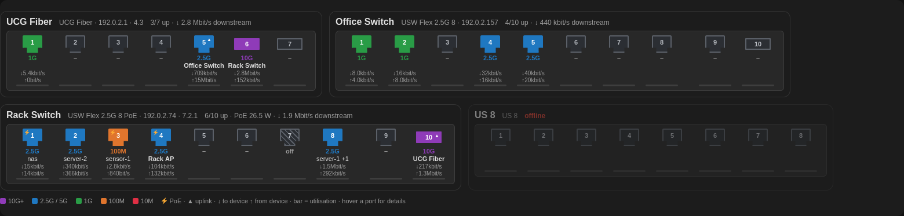

# UniFi Switch Ports

A Home Assistant integration that shows the ports of all your UniFi switches the
way they look from the front: link state, negotiated speed, what is plugged in,
data rate and PoE for every port. It includes a Lovelace card and a few sensors.



## Features

- **Front-panel view** of every switch and of the gateway's switch ports, using
  Ubiquiti's own port diagrams (odd/even rows, SFP cages, gaps between port groups).
- Per port: **link up/down/disabled**, **speed** (colour coded), **connected device or
  client** (UniFi devices through the controller's LLDP data, clients through the
  client list), **data rate** in both directions with a utilisation bar,
  **PoE power**, **uplink** and **SFP module**. Hover a port for all details.
- Offline switches are shown greyed out.
- Per switch a device with the sensors **Ports up** and **PoE power** (only for
  switches with PoE ports), for use in automations or history graphs.
- Several sites or controllers: add the integration once per site and pick the site
  in the card.
- Talks to the controller only, with a read-only **API key**. No UniFi account
  credentials, no cloud.

## Requirements

- Home Assistant 2026.9 or newer.
- A UniFi console (Cloud Gateway, Dream Machine, UniFi OS Server, …) or a UniFi
  Network application that supports API keys (UniFi Network 9.0 or newer).
- An API key: in UniFi Network go to **Settings → Control Plane → Integrations** and
  create one.

## Installation

### HACS

[](https://my.home-assistant.io/redirect/hacs_repository/?owner=raaaimund&repository=ha-unifi-switch-ports&category=integration)

Or add it by hand: **HACS → ⋮ → Custom repositories**, repository
`https://github.com/raaaimund/ha-unifi-switch-ports`, type *Integration*. Then download
**UniFi Switch Ports** and restart Home Assistant.

### Manual

Copy `custom_components/unifi_switch_ports` into the `custom_components` directory of
your Home Assistant configuration and restart Home Assistant.

## Configuration

**Settings → Devices & services → Add integration → UniFi Switch Ports**

| Field | Description |
|---|---|
| Controller URL | Address of the console or Network application, e.g. `https://192.168.1.1` |
| API key | The UniFi Network API key |
| Verify SSL certificate | Off by default, because UniFi consoles use a self-signed certificate |

If the API key has access to several sites you pick one; add the integration again for
more sites. A rejected API key starts a re-authentication. URL, key and certificate
check can be changed later with **Reconfigure**.

The controller is polled every 30 seconds, about as often as UniFi refreshes its port
statistics.

## The card

The integration serves the card itself and registers it as a dashboard resource
(`/unifi_switch_ports/unifi-switch-ports-card.js?v=<version>`), updating the version on
upgrades and removing it with the last config entry. You don't have to add it yourself.
With dashboards in YAML mode it is loaded as an extra frontend module instead. Open
browser tabs load resources only on a page load, so after adding or updating the
integration reload Home Assistant in the browser once. A notification reminds you; it
disappears as soon as a card is running, and the browser console then shows
`UNIFI-SWITCH-PORTS-CARD <version>`. In a dashboard choose **Add card → UniFi Switch Ports**,
or in YAML:

```yaml
type: custom:unifi-switch-ports-card
```

| Option | Default | Description |
|---|---|---|
| `entry_id` | first entry | The UniFi site (config entry) to show; the card editor offers a picker |
| `show_offline` | `true` | Also show switches that are offline (card editor: *Show offline switches*) |
| `show_legend` | `true` | Show the colour legend below the switches |

The card takes the full width in sections views. Its data comes over a websocket
subscription (`unifi_switch_ports/subscribe`) rather than entity attributes, so the
port data neither bloats the state machine nor the recorder.

## Sensors

| Entity | Description |
|---|---|
| `sensor.<switch>_ports_up` | Number of ports with link |
| `sensor.<switch>_poe_power` | PoE power drawn by all ports, in W |

## How the port layouts work

`custom_components/unifi_switch_ports/models.json` maps UniFi model codes to the
product name and the front-panel diagram from Ubiquiti's public device database
(`static.ui.com/fingerprint/ui/public.json`, the one the UniFi apps use). Models without
a diagram, mostly older switches, get a generated layout: copper ports in one row
(odd/even rows above 12 ports), SFP cages after a gap. Refresh the table with:

```bash
python3 scripts/update_models.py
```

## Development

The repository follows the
[integration blueprint](https://github.com/ludeeus/integration_blueprint).

```bash
scripts/setup                            # install Home Assistant and ruff
python3 -m pip install -r requirements_test.txt
scripts/test                             # pytest
scripts/lint                             # ruff format + ruff check
scripts/develop                          # run Home Assistant with the integration on :8123
```

The GitHub workflows run hassfest, the HACS validation, ruff and the tests. A Gitea
mirror runs `.gitea/workflows/ci.yaml` instead (ruff, tests, hassfest); it takes the
commit from GitHub and needs no secrets.

## License

MIT
